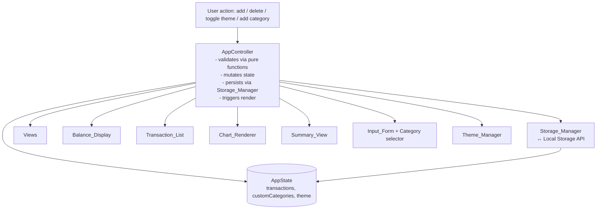

# Design Document

## Overview

The Expense & Budget Visualizer is a fully client-side single-page web application built with plain HTML, CSS, and Vanilla JavaScript — no frameworks, no build step, no backend. Users record expense transactions through an input form, view them in a scrollable list, see a live total balance, visualize spending distribution as a pie chart, switch between dark and light themes, and review monthly summaries. All persistence happens in the browser's Local Storage API; no data ever leaves the device.

The application is organized as a small set of cooperating modules inside a single JavaScript file (`js/app.js`). A central controller owns a single source-of-truth state object and imperatively re-renders the affected views whenever state changes. Pure functions handle all data transformation and validation (balance, category/month aggregation, serialization, validation rules) so they can be tested independently of the DOM and the browser storage APIs.

### Scope and Non-Goals

In scope: transaction CRUD, balance display, pie chart, Local Storage persistence with error handling, theme toggle, monthly summary, custom categories, and the performance/usability/compatibility requirements.

Non-goals: multi-user sync, server-side storage, authentication, budget limits/income tracking (transactions are expenses only), offline-first service workers, and internationalization.

### Requirements Coverage

This design addresses all 11 requirements from `requirements.md`:

| Req | Title | Primary owner component(s) |
|-----|-------|------------------------------|
| 1 | Add Transactions via Input Form | `Input_Form`, `Category_Manager`, validation pure functions |
| 2 | View and Manage Transaction List | `Transaction_List`, `Storage_Manager` |
| 3 | Display Total Balance | `Balance_Display`, `computeBalance` |
| 4 | Visualize Spending by Category | `Chart_Renderer`, `aggregateByCategory` |
| 5 | Persist Data Using Local Storage | `Storage_Manager`, `serialize`/`deserialize` |
| 6 | Toggle Dark and Light Theme | `Theme_Manager` |
| 7 | View Monthly Summary | `Summary_View`, `groupByMonth`, `summarizeMonth` |
| 8 | Add Custom Categories | `Category_Manager`, `validateCategoryName` |
| 9 | Application Performance | `AppController` rendering strategy, `DocumentFragment`, event delegation |
| 10 | Application Design and Usability | CSS file, `Theme_Manager` variables, visual hierarchy |
| 11 | Browser Compatibility | Feature detection in `Storage_Manager`, standalone load |

## Architecture

### High-Level Architecture

The application follows a **single-source-of-truth + imperative re-render** pattern, the standard approach for framework-free JavaScript apps. One state object holds the entire application state; every user action flows through the `AppController`, which validates input, mutates state, persists the change, and re-renders the views that depend on the changed slice of state.



### Rendering Strategy

Because there is no virtual DOM, re-rendering is imperative and targeted:

- **List rendering** uses a `DocumentFragment` to rebuild the `Transaction_List` in memory and attach it in one operation, avoiding layout thrash (supports Req 9.3 — under 500ms for 100+ entries).
- **Delete** uses event delegation on the list container; a single listener reads the transaction id from a `data-id` attribute on the clicked delete control.
- **Balance, Chart, Summary** are recomputed from the same in-memory state and re-rendered on each mutation. For the expected transaction volumes (hundreds, not millions) a full recompute is well within the 200ms / 500ms budgets in Requirement 9.
- **Theme** is applied by setting a `data-theme` attribute on the document root and is driven entirely by CSS variables, so toggling is instant and does not touch the DOM structure.

### File Layout

```
/
├── index.html        # structure only: semantic markup, links css + js
├── css/
│   └── styles.css    # the single CSS file (Req 10.3)
└── js/
    └── app.js        # the single JavaScript file (Req 10.4)
```

`index.html` links `css/styles.css` in the head and loads `js/app.js` with `defer` so the script runs after the DOM is parsed.

### Module Organization Inside app.js

A single file does not mean a single blob. `app.js` is wrapped in one IIFE and is divided into clearly commented sections that mirror the glossary components:

```
(function () {
  'use strict';

  // --- Constants & storage keys ---
  // --- Pure logic layer (no DOM, no storage) ---
  //     computeBalance, aggregateByCategory, groupByMonth,
  //     summarizeMonth, validateTransaction, validateCategoryName,
  //     serializeState, deserializeState, isNonEmpty, isPositiveAmount
  // --- Storage_Manager ---
  // --- Theme_Manager ---
  // --- View renderers ---
  //     renderBalance, renderTransactionList, renderChart,
  //     renderSummary, renderCategorySelector, renderMessages
  // --- AppController (init, event wiring, state mutation) ---
})();
```

The **pure logic layer** sits at the top with no DOM or storage imports, which makes it independently testable (see Testing Strategy). Views are thin functions that read state and write DOM; the controller is the only place that orchestrates side effects.

## Components and Interfaces

### AppController

The orchestrator. Owns the `state` object, wires up event listeners, and exposes the mutation entry points.

| Member | Signature | Responsibility |
|--------|-----------|----------------|
| `init` | `() => void` | On DOMContentLoaded: detect storage availability, load persisted state, apply theme, render all views, bind events. |
| `handleAddTransaction` | `(formValues) => void` | Validate via `validateTransaction`; on success push a `Transaction`, persist, re-render list/balance/chart/summary. |
| `handleDeleteTransaction` | `(id) => void` | Remove transaction by id, persist, re-render. |
| `handleToggleTheme` | `() => void` | Flip theme, persist, apply. |
| `handleAddCategory` | `(name) => void` | Validate via `validateCategoryName`; on success add to `customCategories`, persist, re-render selector. |
| `handleSelectMonth` | `(monthKey) => void` | Set selected month in summary and re-render the month detail. |
| `render` | `(what) => void` | Selective re-render dispatcher (balance, list, chart, summary, selector, theme). |

### Storage_Manager

Encapsulates all Local Storage access so the rest of the app never touches `localStorage` directly. Every method is wrapped in try/catch and reports errors through a message callback rather than throwing.

| Member | Signature | Responsibility / Req |
|--------|-----------|----------------------|
| `isAvailable` | `() => boolean` | Feature-detect `window.localStorage` and a write/read probe. Req 5.4, 11.3 |
| `loadTransactions` | `() => {ok, data, error}` | Read+parse+validate stored transactions; on corrupt data return `ok:false` and an error message. Req 5.2, 5.5 |
| `saveTransactions` | `(transactions) => {ok, error}` | Serialize and write; on quota/unavailable keep data in memory and return `ok:false`. Req 5.1, 5.4 |
| `loadCategories` | `() => {ok, data, error}` | Load custom categories; on failure return defaults-only signal. Req 8.4, 8.7 |
| `saveCategories` | `(categories) => {ok, error}` | Persist custom categories. Req 8.3 |
| `loadTheme` | `() => {ok, data, error}` | Load stored theme. Req 6.4 |
| `saveTheme` | `(theme) => {ok, error}` | Persist theme. Req 6.3 |

Storage keys: `ebv:transactions`, `ebv:categories`, `ebv:theme`. Each value is a JSON string. Versioning is handled by the schema validation in `deserializeState` (see Data Models); unrecognized or malformed payloads are treated as corrupt.

### Theme_Manager

| Member | Signature | Responsibility / Req |
|--------|-----------|----------------------|
| `applyTheme` | `(theme) => void` | Set `data-theme` attribute on `<html>`. Req 6.2 |
| `toggle` | `(current) => 'dark'\|'light'` | Pure: returns the opposite theme. Req 6.1 |
| `defaultTheme` | `() => 'light'` | Constant default for first load. Req 6.5 |

### Input_Form (view + controller binding)

| Member | Signature | Responsibility / Req |
|--------|-----------|----------------------|
| `renderCategorySelector` | `(allCategories) => void` | Rebuild `<select>` options from defaults + custom. Req 1.2, 8.2 |
| `readForm` | `() => {itemName, amount, category}` | Read raw field values (strings). |
| `showFormErrors` | `(errors[]) => void` | Render validation messages near the form. Req 1.4, 1.5 |
| `clearForm` | `() => void` | Reset fields after a successful add. |

### Transaction_List (view)

| Member | Signature | Responsibility / Req |
|--------|-----------|----------------------|
| `render` | `(transactions) => void` | Build list via `DocumentFragment`; each row shows item, amount, category, and a delete control with `data-id`. Req 2.1–2.3 |
| `renderEmpty` | `() => void` | Show "no transactions" message. Req 2.6 |
| `onDelete` | `(callback) => void` | Event-delegated listener wired in `init`. Req 2.4 |

### Balance_Display (view)

| Member | Signature | Responsibility / Req |
|--------|-----------|----------------------|
| `render` | `(balance) => void` | Format and display total at the top. Req 3.1, 3.4 |

### Chart_Renderer (view + Canvas)

| Member | Signature | Responsibility / Req |
|--------|-----------|----------------------|
| `render` | `(transactions) => void` | If none, show empty message; else draw pie chart on `<canvas>` plus a legend. Req 4.1, 4.3 |
| `drawPie` | `(ctx, totals, palette) => void` | Compute slice angles from `aggregateByCategory` and draw with `arc()`. Req 4.1 |

### Summary_View (view)

| Member | Signature | Responsibility / Req |
|--------|-----------|----------------------|
| `render` | `(transactions) => void` | List months that have at least one transaction; show empty message otherwise. Req 7.1, 7.3, 7.4 |
| `renderMonthDetail` | `(monthKey, transactions) => void` | Show month total + per-category breakdown. Req 7.2 |

### Category_Manager (view + controller binding)

| Member | Signature | Responsibility / Req |
|--------|-----------|----------------------|
| `addCustomCategory` | `(name) => {ok, error}` | Validate via `validateCategoryName`, mutate state, persist, re-render selector. Req 8.1, 8.2, 8.3 |
| `showCategoryError` | `(message) => void` | Render rejection reason. Req 8.5, 8.6, 8.7 |

## Data Models

All persistent data is plain JSON-serializable. The pure logic functions operate on these shapes directly.

### Transaction

```json
{
  "id": "txn_1700000000000_3",      // string, unique, generated client-side
  "itemName": "Lunch",               // non-empty string (trimmed)
  "amount": 12.50,                   // positive number (> 0)
  "category": "Food",                // string: a default or custom category name
  "date": "2025-10-26T14:30:00.000Z" // ISO 8601 timestamp (UTC)
}
```

- `id` is generated as `txn_${Date.now()}_${counter}` to remain unique within a session and stable across reloads.
- `amount` is stored as a number; the input string is parsed with `Number()` and validated to be finite and `> 0`.
- `date` is stored in UTC ISO form so monthly grouping is deterministic regardless of locale. Grouping uses the calendar month derived from this value.

### Category

Categories are plain strings. The full category list shown in the selector is the concatenation of default categories `['Food', 'Transport', 'Fun']` with the persisted custom categories. Only custom categories are persisted; defaults are hardcoded constants.

### AppState (in-memory single source of truth)

```json
{
  "transactions": [ /* Transaction[] */ ],
  "customCategories": [ /* string[] */ ],
  "theme": "light",
  "selectedMonth": null
}
```

`selectedMonth` is UI-only state (which month is expanded in the summary) and is not persisted.

### Local Storage Schema

| Key | JSON value | Notes |
|-----|------------|-------|
| `ebv:transactions` | `Transaction[]` | Whole array replaced on every save. |
| `ebv:categories` | `string[]` | Custom categories only. |
| `ebv:theme` | `"dark"` or `"light"` | Plain JSON string. |

### Serialization and Validation Helpers (pure)

- `serializeState(state) -> string` — JSON-stringify the persistent subset.
- `deserializeTransactions(json) -> {ok, data, error}` — parse, then schema-validate each entry: must be an object with string `id`, non-empty string `itemName`, finite positive `amount`, non-empty string `category`, valid ISO `date`. Any failure → `ok:false`, controller initializes an empty list and surfaces a message (Req 5.5).
- `isStoredTransaction(x) -> boolean` — the per-entry structural check used by `deserializeTransactions`.

### Validation Result Types

Validation functions return a discriminated result rather than throwing, so the UI can render all problems at once:

```js
// validateTransaction
{ valid: boolean, errors: string[] }

// validateCategoryName
{ valid: boolean, reason: string | null }
```

## Correctness Properties

*A property is a characteristic or behavior that should hold true across all valid executions of a system — essentially, a formal statement about what the system should do. Properties serve as the bridge between human-readable specifications and machine-verifiable correctness guarantees.*

These properties cover the pure logic layer of the application (`computeBalance`, `aggregateByCategory`, `groupByMonth`, `summarizeMonth`, `validateTransaction`, `validateCategoryName`, and the `serialize`/`deserialize` helpers). DOM rendering, Canvas drawing, theme attribute application, and Local Storage I/O are not covered here; they are addressed by the example-based and integration tests in the Testing Strategy. The properties below were derived from the acceptance-criteria prework and consolidated to remove redundancy.

### Property 1: Category selector content

*For any* set of custom categories, the rendered category selector SHALL contain exactly the default categories (Food, Transport, Fun) plus the custom categories, with no duplicates and no missing entries.

**Validates: Requirements 1.2, 8.2**

### Property 2: Valid submission grows the transaction list

*For any* valid transaction input and any starting transaction list, adding the transaction SHALL increase the list length by exactly one, and the new transaction SHALL be the last element with data matching the submitted input.

**Validates: Requirements 1.3**

### Property 3: Transaction validation correctness

*For any* form input, `validateTransaction` SHALL accept if and only if every field is non-empty after trimming (not composed solely of whitespace) and the amount is a finite positive number. Any input failing either condition SHALL be rejected and SHALL result in no transaction being added.

**Validates: Requirements 1.4, 1.5**

### Property 4: Transaction list rendering completeness

*For any* set of transactions, rendering the list SHALL produce exactly one row per transaction, and each row SHALL display that transaction's item name, amount, and category, together with one delete control.

**Validates: Requirements 2.1, 2.2, 2.3**

### Property 5: Deletion removes exactly one transaction

*For any* transaction list that contains a transaction `t`, deleting `t` SHALL produce a list whose length is one less, that no longer contains `t`, and that preserves every other transaction unchanged.

**Validates: Requirements 2.4**

### Property 6: Balance equals the sum of amounts

*For any* transaction list, `computeBalance` SHALL equal the sum of all transaction amounts. In particular, for the empty list the balance SHALL be zero.

**Validates: Requirements 3.1, 3.2, 3.3, 3.4**

### Property 7: Category aggregation confluence

*For any* transaction list, `aggregateByCategory` SHALL produce exactly one total for each category that appears in the list, and the sum of all category totals SHALL equal the total balance (the sum of all transaction amounts).

**Validates: Requirements 4.1**

### Property 8: State serialization round trip

*For any* valid application state (transactions, custom categories, and theme), serializing the state and then deserializing the result SHALL yield an equivalent state, preserving every transaction, every custom category, and the theme value.

**Validates: Requirements 5.2, 8.4**

### Property 9: Corrupt data rejection

*For any* stored payload that is malformed JSON or contains a schema-invalid transaction, deserialization SHALL reject the payload (return a failure result) and SHALL yield an empty transaction set, so the application can initialize cleanly.

**Validates: Requirements 5.5**

### Property 10: Theme toggle involution

*For any* theme value `t` in {light, dark}, toggling SHALL produce the opposite theme, and toggling twice SHALL return the original theme (that is, `toggle(toggle(t)) === t`).

**Validates: Requirements 6.2**

### Property 11: Monthly partition

*For any* transaction list, `groupByMonth` SHALL assign every transaction to exactly one month group, SHALL create a group only for months that contain at least one transaction, and the sum of all month totals SHALL equal the total balance.

**Validates: Requirements 7.1, 7.3**

### Property 12: Monthly summary totals

*For any* month group, the month total SHALL equal the sum of that month's transactions, and the sum of the per-category breakdown for that month SHALL equal the month total.

**Validates: Requirements 7.2**

### Property 13: Custom category name validation

*For any* proposed category name, existing category set (defaults plus customs), and current custom-category count, `validateCategoryName` SHALL accept if and only if the name is between 1 and 50 characters, is not composed solely of whitespace, does not duplicate any existing category name, and the custom-category count is less than 20. Any input failing one or more of these conditions SHALL be rejected.

**Validates: Requirements 8.1, 8.5, 8.6**

## Error Handling

Errors are handled at the boundary (storage I/O, parsing, validation) and reported to the user through non-blocking inline messages. The app never throws an uncaught exception into the UI path.

- **Local Storage unavailable / disabled** (`Storage_Manager.isAvailable() === false`, or `SecurityError`/`AccessDenied`): The app still runs in-memory. A persistent banner explains data will not be saved (Req 5.4, 11.3). Custom categories fall back to defaults only (Req 8.7).
- **Quota exceeded** (`QuotaExceededError` / `NS_ERROR_DOM_QUOTA_REACHED`): `saveTransactions` returns `{ok:false}`; in-memory transactions are retained; a message tells the user the save failed (Req 5.4).
- **Corrupt stored data** (JSON parse error or schema validation failure): `loadTransactions` returns `{ok:false, error}`; the controller initializes an empty list and shows a "stored data could not be loaded" message (Req 5.5). Corrupt categories/theme keys are ignored and defaults applied silently for theme, or surfaced for categories per Req 8.7.
- **Form validation** (Req 1.4, 1.5): Empty/whitespace-only fields and non-numeric/zero/negative amounts are rejected before any state mutation; the form is not cleared and errors render inline.
- **Category validation** (Req 8.5, 8.6): Empty, >50 char, whitespace-only, duplicate, or limit-reached submissions are rejected with a specific reason; the selector is unchanged.
- **Empty states**: Transaction list (Req 2.6), chart (Req 4.3), and summary (Req 7.4) each show a dedicated empty-state message rather than rendering nothing.
- **Browser without Local Storage** (Req 11.3): Detected at init; the app loads with default state and shows the persistence-unavailable message.

## Testing Strategy

The application splits naturally into a **pure logic layer** and a **DOM/storage layer**. The pure layer is the source of correctness and is tested heavily with property-based tests; the DOM/storage layer is tested with example-based unit tests and a small set of integration tests.

### PBT Applicability Assessment

Property-based testing **is appropriate** for the pure logic layer because those functions are pure, have clear input/output behavior, and their correctness varies meaningfully with input over a large input space (collections of transactions, arbitrary strings, numbers). It is **not** appropriate for DOM rendering, Canvas drawing, theme attribute application, or Local Storage I/O — those are verified with example-based and integration tests instead.

### Unit Tests (example-based)

Run with a standard runner (e.g., Vitest in `--run` mode) against the pure functions imported in isolation and against view renderers using a jsdom environment.

- Specific examples demonstrating correct behavior: adding a transaction, deleting a transaction, toggling theme, selecting a month.
- Integration points: controller wiring `validateTransaction` → state → `saveTransactions` → re-render.
- Edge cases: empty form, zero/negative amount, non-numeric amount, 50-character and 51-character category names, exactly 20 custom categories, duplicate category, corrupt JSON, quota-exceeded simulation.

### Property-Based Tests

Use `fast-check` (Node/TS-compatible PBT library). Each correctness property in the section above is implemented as a **single** property-based test. Each test runs a minimum of **100 iterations**. Each test is tagged with a comment referencing its design property in the form:

`// Feature: expense-budget-visualizer, Property N: <property text>`

The pure functions exercised under PBT are: `computeBalance` (Property 6), `aggregateByCategory` (Property 7), `groupByMonth` (Property 11), `summarizeMonth` (Property 12), `validateTransaction` (Property 3), `validateCategoryName` (Property 13), the state-append/delete mutators (Properties 2 and 5), the category-selector builder (Property 1), the `toggle` helper (Property 10), and the `serialize`/`deserialize` helpers (Properties 8 and 9).

### Integration Tests

- Load the app in a jsdom environment, simulate adding and deleting transactions, and assert the DOM reflects the change (balance, list, chart empty-state toggle).
- Simulate `localStorage` being unavailable (delete `window.localStorage`) and assert the in-memory app still works and shows the persistence-unavailable message.
- Simulate a quota-exceeded throw from `setItem` and assert in-memory data is retained.
- Simulate corrupt stored JSON and assert the app initializes empty and shows the load-error message.

### Non-Functional Verification (manual / example-based)

- **Performance (Req 9)**: Generate 100+ transactions in a test harness, perform an add/delete, and assert the affected display updates within the budget. These are example-based, not PBT, because behavior does not vary meaningfully with input.
- **Usability (Req 10)**: Verify single CSS and JS file counts; check 16px minimum font size and 4.5:1 contrast ratios with a contrast-checker example. Visual hierarchy is verified by example inspection.
- **Browser compatibility (Req 11)**: Smoke-test in current Chrome, Firefox, Edge, and Safari — a single representative run each, not PBT.
